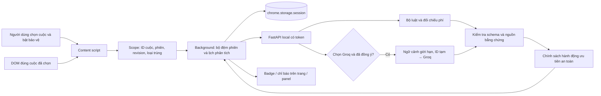

# Kế hoạch phát triển ChatGuard VN

Phiên bản 1.1 · Rà soát ngày 14/10/2026 · Nhóm 3 thành viên

Tên sản phẩm: **ChatGuard VN**. Tên repo: **`chatguard-vn`**.

Tài liệu này điều chỉnh đề xuất nhóm theo mã hiện có và nguồn lực triển khai. Các mục ghi “tiếp theo” chưa phải tính năng đã hoàn thành. Bản đề xuất gốc được giữ nguyên để tham khảo.

## 1. Định vị sản phẩm

ChatGuard VN hỗ trợ người dùng nhận biết dấu hiệu lừa đảo và thao túng trong **một cuộc trò chuyện do chính họ chọn**, ưu tiên tuyển cộng tác viên và việc làm qua mạng. Tiện ích theo dõi phần văn bản trang đã tải, phân tích diễn biến và đưa cảnh báo có bằng chứng.

Giá trị chính là vòng bảo vệ ngay trong lúc nhắn tin: chọn một người → theo dõi đúng phạm vi → đối chiếu nội dung theo thời gian → cảnh báo khi cần → xem nguồn → dừng và xóa. Không yêu cầu người dùng liên tục sao chép hội thoại sang một chatbot.

Mở rộng về an toàn cá nhân theo **hành vi quan sát được**, ví dụ yêu cầu giao hộ chiếu bản gốc hoặc cấm liên lạc với người thân. Không định vị MVP là hệ thống xác định tội phạm hay phát hiện mua bán người.

## 2. Các điều chỉnh so với đề xuất nhóm

| Hạng mục | Quyết định sau review | Lý do |
|---|---|---|
| Tên dự án | Giữ ChatGuard VN / `chatguard-vn` | Theo quyết định của nhóm |
| Phạm vi tuyển dụng, dụ dỗ, mua bán người | Tuyển dụng/CTV là tình huống chính; một số dấu hiệu kiểm soát cá nhân là lớp bảo vệ bổ sung | Dễ xây bộ tình huống, giải thích và đo chất lượng |
| 14 tuần từ đầu | Sprint củng cố 3 ngày từ nền đã có, sau đó mở rộng theo kết quả | Extension, backend, Groq và phòng thử đã tồn tại |
| Nhóm 4–6 người | Một người kỹ thuật, hai người AI/ML; chia rõ đầu ra | Sát nhân lực thực tế |
| IndexedDB hoặc bộ nhớ tạm | Giữ `chrome.storage.session` cho nội dung và token local | IndexedDB tồn tại lâu hơn phiên nếu không có chính sách dọn riêng |
| Bốn cấp cảnh báo mới | Giữ schema hiện tại; an toàn cá nhân dùng `high_concern` kèm hướng dẫn ưu tiên | Tránh đổi hợp đồng API/UI trước khi có dữ liệu hiệu chuẩn |
| Claim ledger nhiều loại | Bắt đầu đối chiếu điều kiện phí, giữ ID và văn bản nguồn | Có thể nghiệm thu bằng cặp bằng chứng trước/sau |
| Độ chắc chắn/điểm số | Không hiển thị phần trăm tự sinh | Chưa có dữ liệu để hiệu chuẩn |
| Tạm dừng và tiếp tục | Đưa vào bước bổ sung sau ổn định; không gọi nút dừng/xóa hiện tại là tạm dừng giữ dữ liệu | Hai hành vi có chính sách dữ liệu khác nhau |
| Xuất báo cáo | JSON/HTML cục bộ ở bước bổ sung; chưa cần PDF | Giảm phụ thuộc và tránh nhầm với nhập/xuất kịch bản demo |
| Feedback “đã xác minh” | Chỉ ghi nhận ý kiến người dùng; không tự biến thành nhãn đúng hoặc hạ cảnh báo | Chưa có quy trình kiểm chứng và huấn luyện |

## 3. Người dùng và kịch bản ưu tiên

Người dùng đầu tiên là sinh viên/người tìm việc qua Facebook trên máy tính, cần biết khi nào nên dừng trước khi chuyển tiền, chia sẻ mã truy cập hoặc chấp nhận điều kiện bất thường.

Ưu tiên triển khai và đánh giá:

1. Tuyển CTV làm nhiệm vụ, yêu cầu phí kích hoạt/ứng tiền rồi đòi nạp thêm để rút tiền.
2. Ban đầu nói không thu phí, sau yêu cầu nộp tiền: dẫn cả hai phát biểu, ghi “điều kiện thay đổi, cần xác minh”.
3. Yêu cầu gửi OTP/mật khẩu: cảnh báo dựa trên bên gửi và yêu cầu cụ thể.
4. Yêu cầu giao giấy tờ gốc hoặc cấm liên lạc người thân: ưu tiên an toàn, không gợi ý tiếp tục hỏi thử/đối đầu.
5. Ca đối chứng: tuyển dụng bình thường, hẹn phỏng vấn, mang bản sao giấy tờ, cảnh báo đừng gửi OTP, câu hỏi về phí, sửa sai có giải thích.

Không dùng thiếu tên công ty, lương cao hoặc một lời mời đi lại đơn lẻ làm bằng chứng chắc chắn về lừa đảo.

## 4. Phạm vi và trạng thái thật của MVP

| Thành phần | Trạng thái |
|---|---|
| MV3, WXT, React/TypeScript, side panel | Có trong mã |
| FastAPI local, token, giới hạn đầu vào/lượt gọi | Có trong mã |
| Bộ luật và Groq tùy chọn, đồng ý gửi dữ liệu riêng | Có trong mã; chưa có model fine-tune |
| Chọn một đối tượng trong nhiều ô chat nhỏ Facebook | Có; fixture và thử nghiệm trên hai tài khoản được phép |
| Giữ đối tượng khi đóng panel | Có; phân tích do background điều phối |
| Giữ đối tượng khi đóng ô chat Facebook | Có; chờ nếu Facebook gỡ log khỏi DOM |
| Bộ đệm 100/300 tin, nạp phần lịch sử trang tải được | Có; không bảo đảm lấy đủ số lượng |
| Badge và chỉ báo trên trang khi có cảnh báo | Có; không phải dấu xác nhận an toàn |
| Cặp phát biểu không thu phí → yêu cầu tiền | Baseline mới, giới hạn theo các mẫu đã kiểm thử |
| Hướng dẫn ưu tiên an toàn cho yêu cầu kiểm soát cụ thể | Baseline mới; chưa phải mô hình nhận diện mọi tình huống dụ dỗ |
| Dừng và xóa phiên | Có; dừng thu thập và loại kết quả đến muộn |
| Tạm dừng giữ bộ đệm / tiếp tục cùng phiên | Tiếp theo; trạng thái `paused` hiện có sau stop không có nghĩa tính năng này đã hoàn thành |
| Xem toàn bộ bản nháp, xuất báo cáo trong panel | Tiếp theo; nhập/xuất JSON phòng thử không thay thế tính năng này |
| Ledger cho lương, địa điểm, doanh nghiệp | Chưa có |
| Phản hồi cảnh báo và lịch sử tín hiệu riêng | Chưa có |
| Số liệu chất lượng độc lập/triển khai công khai | Chưa có |

## 5. Kiến trúc triển khai

- Content script chịu trách nhiệm **đọc đúng phạm vi**, không giữ khóa Groq hoặc quyết định gọi AI.
- Background là nơi điều phối phiên và lịch phân tích; panel chỉ hiển thị và gửi lệnh người dùng. Đóng panel không dừng phiên.
- Backend hiện chạy trên `127.0.0.1`. Bộ luật nằm ở Python, không tuyên bố đã chạy hoàn toàn trong extension. Chuyển rules sang trình duyệt chỉ khi có nhu cầu loại backend cho chế độ đó.
- Tiếp tục dùng cấu trúc `apps/extension`, `apps/api`, `ml`, `docs`, `scripts`. Chưa cần monorepo framework mới, database, vector DB, message broker hoặc Docker bắt buộc.
- API lỗi không tự đổi nhà cung cấp, không biến thành đánh giá an toàn và không tự hạ cảnh báo cũ.

## 6. Thu thập và vòng đời dữ liệu

### 6.1. Giới hạn ngữ cảnh

- Mức 1: tối đa 100 tin / 24.000 ký tự trong bộ đệm.
- Mức 2: tối đa 300 tin / 72.000 ký tự trong bộ đệm.
- Không chờ đủ 100/300 tin mới phân tích. Tin chỉ lấy được nếu trang đã tải và bộ đọc xác minh đúng đối tượng.
- Bộ luật nhận bộ đệm được chọn. Groq nhận tối đa 40 tin / 6.000 ký tự mỗi lượt, gồm phần gần nhất và một số phát biểu cũ về phí còn trong bộ đệm.
- Mốc cũ được gửi nguyên văn cùng nguồn, không dùng tóm tắt AI làm bằng chứng. Không bảo đảm giữ mọi sự kiện; tin ngoài bộ đệm có thể mất.
- Các tin đưa vào Groq có thể không liên tục. Mô hình phải biết khoảng trống không chứng minh một sự kiện chưa xảy ra.

### 6.2. Lịch phân tích và cảnh báo

Chọn kiểm tra sau mỗi tin hoặc gộp 5 tin. Gom thay đổi để tránh gọi lại chỉ vì DOM dựng lại. Lượt đầu và nội dung cần ưu tiên được đưa vào lịch sớm; bộ hẹn không tự kết luận rủi ro.

Groq cách tối thiểu 30 giây giữa các lượt. Nhóm chưa đủ 5 tin chờ khoảng 45 giây. Background dùng timer và alarm, phục hồi lịch từ session storage khi worker hoạt động lại. Máy ngủ hoặc trình duyệt điều tiết có thể khiến kết quả chậm hơn; đây không phải cam kết độ trễ tuyệt đối.

### 6.3. Trạng thái phiên

| Thao tác/trạng thái | Chính sách |
|---|---|
| Chưa bật bảo vệ | Chỉ metadata để chọn người; không lấy nội dung các cuộc |
| Đang bảo vệ | Đọc đúng cuộc được chọn; giữ bộ đệm giới hạn |
| Đóng panel | Background tiếp tục xử lý khi nguồn tin còn khả dụng |
| Đóng ô chat nhỏ | Giữ đối tượng và bộ đệm; không đọc người khác; chờ log đúng cuộc được tải lại |
| Mở chat người khác | Không tự đổi đối tượng; chỉ đọc lại khi đúng ID được xác minh |
| Tải lại/đóng tab hoặc đổi đường dẫn | Dừng phiên theo hành vi hiện tại |
| Dừng và xóa | Hủy lịch, yêu cầu đang chạy, xóa dữ liệu phiên do ứng dụng quản lý |
| Reload/cập nhật/tắt extension hoặc restart trình duyệt | Session storage bị xóa; không tự khôi phục quyền đọc |
| Xuất file sau này | File thuộc người dùng; xóa phiên không xóa file đã tải hoặc dữ liệu nhà cung cấp đã nhận |

Nguồn kỹ thuật: [Chrome storage](https://developer.chrome.com/docs/extensions/reference/api/storage?hl=en), [Chrome alarms](https://developer.chrome.com/docs/extensions/reference/api/alarms). IndexedDB không có cùng vòng đời tự xóa của `storage.session`.

## 7. Phân tích và đối chiếu phát biểu

Giữ schema mức độ đang dùng:

| Giá trị | Nhãn UI | Ý nghĩa |
|---|---|---|
| `no_signal` | Chưa thấy dấu hiệu rõ | Không phải chứng nhận an toàn |
| `review` | Cần kiểm chứng | Có tín hiệu cần xem lại với nguồn cụ thể |
| `high_concern` | Có dấu hiệu đáng lo | Có yêu cầu rủi ro rõ hoặc tổ hợp tín hiệu |
| `insufficient_context` | Chưa đủ ngữ cảnh | Không đủ cơ sở đánh giá đáng tin cậy |

Đây là mức cảnh báo, không phải xác suất phạm tội. Không thêm “nghiêm trọng” chỉ để tạo thêm màu UI khi chưa có tiêu chí và dữ liệu.

### 7.1. Claim ledger giai đoạn đầu

Ledger hiện là dữ liệu **suy ra trong một lượt**, từ tin còn trong ngữ cảnh; không phải kho lưu trữ lịch sử riêng. Mỗi claim có `source_message_id`, vị trí và loại phát biểu: không thu phí / yêu cầu tiền. Văn bản nguồn vẫn nằm trong bản nháp và là nguồn trích dẫn. Chính sách đối chiếu áp dụng cho rules và kết quả Groq đã hợp lệ; không chạy thay API khi Groq lỗi.

Ca nghiệm thu: “không thu phí” ở mốc đầu → yêu cầu phí ở mốc sau → một signal có **hai ID bằng chứng đúng thứ tự**. Ngôn ngữ cảnh báo là thay đổi điều kiện, cần đối chiếu. Không gọi đây là chứng minh nói dối.

Giới hạn: regex chỉ xử lý mẫu trực tiếp; chưa hiểu toàn bộ tiếng vùng miền, câu điều kiện, lời trích dẫn và giải thích phức tạp. Các thay đổi có giải thích hợp lý cần bộ hard negatives và đánh giá ngữ cảnh. Không công bố ledger tổng quát cho lương/địa điểm/doanh nghiệp trước khi làm và kiểm thử.

### 7.2. Vai gửi và bằng chứng

- `self` cung cấp ngữ cảnh, không làm bằng chứng quy yêu cầu của đối phương.
- `unknown` không được gán hành vi cho đối phương; thiếu vai gửi phải báo giới hạn.
- Cảnh báo phải có ID trong đầu vào; UI lấy câu trích từ tin nguồn, không lấy câu bịa từ mô hình.
- Đầu ra chỉ được áp dụng khi ID cuộc + phiên + revision còn khớp. Tin sửa, thu hồi hoặc hết bộ đệm có thể làm đánh giá cũ mất hiệu lực.

### 7.3. Ưu tiên an toàn cá nhân

Yêu cầu giao giấy tờ gốc hoặc cấm liên lạc người thân kích hoạt hướng dẫn ưu tiên an toàn trong baseline. Không suy diễn nguy cơ từ việc đến phỏng vấn hoặc mang bản sao giấy tờ. Không gợi ý đi gặp, đối đầu hoặc tiếp tục thăm dò khi đã có tín hiệu kiểm soát cụ thể.

Không đưa số hỗ trợ tùy đoán vào sản phẩm. Việc thêm nguồn hỗ trợ phải được kiểm tra theo địa phương và thời điểm triển khai.

## 8. UX và các bước bổ sung

Màn hình chính giữ gọn: người đang được bảo vệ, trạng thái, kết luận ngắn, tối đa hai hành động chính. Bằng chứng, bản nháp, giới hạn lịch sử và cấu hình nằm ở phần mở thêm.

Thứ tự bổ sung:

1. **Ổn định cập nhật DEV:** mã reader khớp manifest; không crash khi quyền mới chưa được nạp; hướng dẫn phục hồi rõ.
2. **Bản nháp + xuất báo cáo:** mặc định chỉ cảnh báo/bằng chứng; xuất toàn bộ tin là lựa chọn riêng. JSON trước, HTML escape nội dung; PDF sau. Không tải dữ liệu lên server để tạo báo cáo.
3. **Tạm dừng/tiếp tục:** pause ngừng đọc và gọi API nhưng giữ bộ đệm; resume phải xác minh lại đúng ID, giữ một phiên có điểm gián đoạn rõ. Không gom ngầm nội dung trong lúc pause.
4. **Ledger mở rộng và phản hồi:** chỉ sau khi có dữ liệu đánh giá, quy tắc giải thích đính chính và trạng thái hết nguồn.

Không thêm toàn bộ các nút lên màn hình chính. “Đổi người” phải kết thúc/xóa phiên cũ trước khi bắt đầu người mới.

## 9. Đánh giá và dữ liệu

Đầu tiên dùng hội thoại tổng hợp có nhãn, không crawl hội thoại riêng tư và không mặc định dùng dữ liệu người dùng để train. Có sổ nguồn/cấp phép khi bổ sung dữ liệu công khai.

Mỗi ca cần: ID, họ kịch bản, vai gửi, từng mốc tin, dấu hiệu kỳ vọng, cặp bằng chứng, thời điểm cảnh báo sớm nhất có cơ sở, mức cảnh báo và hành động không được đề xuất. Có phiên bản viết tắt/không dấu nhưng phải tách theo **họ kịch bản** khi chia train/dev/test.

Mục tiêu chuẩn bị ban đầu: 30–50 ca đa dạng để tìm lỗi, gồm nhiều ca bình thường/dễ nhầm; đây không phải cỡ mẫu đủ để công bố chất lượng thực tế. Bộ test giữ kín phải tách khỏi ca dùng chỉnh prompt/quy tắc.

Đo riêng:

- Precision/recall theo tín hiệu; báo cả số ca, false positive và false negative.
- Độ đúng của trích dẫn và cặp phát biểu trước/sau.
- Thời điểm cảnh báo trong hội thoại nhiều bước; không chỉ phân tích khi mọi dấu hiệu đã lộ.
- Khả năng xử lý thiếu vai gửi, phủ định, câu hỏi, báo giá hợp lệ, đính chính và prompt injection.
- Đọc nhầm cuộc, trùng tin, mất/sai thứ tự, kết quả đến muộn, xóa phiên và chạy khi panel đóng.
- Độ trễ đọc → xếp lịch → API → hiển thị; tách lỗi/quota khỏi đánh giá nội dung.

Kết quả bộ tình huống phòng thử là regression, không phải đánh giá độc lập. Fine-tune chỉ xét sau khi baseline đã đo, có lỗi rõ và có dữ liệu được phép dùng. Máy 8 GB không cần tải model lớn để triển khai MVP này.

## 10. Phân công nhóm 3 người

| Thành viên | Trách nhiệm chính | Đầu ra có thể review |
|---|---|---|
| Bạn — kỹ thuật sản phẩm | Extension, backend, UX, tích hợp, lifecycle, demo | Bản chạy, lỗi tái hiện được, kiểm thử phạm vi và xóa |
| AI/ML 1 | Taxonomy tín hiệu, dữ liệu tổng hợp, annotation, hard negatives | Dataset có nhãn nguồn và bằng chứng; hướng dẫn gán nhãn |
| AI/ML 2 | Prompt/Groq, đối chiếu phí, bộ đánh giá và phân tích lỗi | Báo cáo theo tín hiệu; so sánh rules/LLM/cấu hình ngữ cảnh |

Cả nhóm cùng duyệt ca bất đồng và kịch bản demo. Hai người AI/ML không cần chờ fine-tune để bắt đầu đóng góp.

## 11. Sprint củng cố 3 ngày từ hiện trạng

| Ngày tương đối | Công việc | Điều kiện hoàn thành |
|---|---|---|
| Ngày 1 | Chốt tài liệu này; ổn định DEV, chọn một người, đóng panel/chat, xóa; ca phí và kiểm soát cá nhân | Các luồng kỹ thuật chạy được; giới hạn ghi đúng |
| Ngày 2 | Nhóm AI/ML làm ca kiểm thử và đánh giá; kỹ thuật làm bản nháp/xuất báo cáo nếu lõi ổn | Có bảng lỗi theo ca; không dùng demo làm test độc lập |
| Ngày 3 | Sửa lỗi ưu tiên, thử đủ một vòng trên hai tài khoản được phép, chuẩn bị demo và báo cáo | Demo lặp lại được; có phương án phòng thử khi DOM/API lỗi |

Đây là thứ tự thực hiện đề xuất, không khẳng định mọi backlog hoàn thành trong 3 ngày. Nếu thiếu thời gian, ưu tiên phạm vi đúng, bằng chứng đúng và kết quả không gây hiểu nhầm trước export/feedback/ledger tổng quát. Chốt ngày nộp theo lịch thực tế của nhóm, không tự suy ra hạn mới từ tài liệu cũ.

## 12. Tiêu chí nghiệm thu và hướng phát triển

MVP đạt vòng đời khi: thiết lập → chọn A → bật bảo vệ → nhận tin đúng A → phân tích và hiển thị nguồn → đóng panel vẫn cập nhật → chat A đóng thì giữ phạm vi/chờ → mở lại A tiếp tục đúng người → dừng/xóa loại nội dung và tác vụ muộn. Nhắn B trong lúc theo dõi A không được đưa B vào ngữ cảnh.

Bản có đối chiếu phí phải chứng minh được cặp trước/sau trong giới hạn bộ đệm; bản có cảnh báo kiểm soát phải dùng hành động ưu tiên an toàn. API lỗi/quota không được hiện kết quả “an toàn”.

Sau MVP: pause/resume, báo cáo cục bộ, ledger nhiều loại, dữ liệu độc lập và đánh giá người dùng. Instagram/Threads, ảnh/voice, xác minh pháp nhân và server công khai là các giai đoạn riêng. Không đổi kiến trúc hoặc xin thêm quyền chỉ vì có trong sơ đồ kế hoạch.

Trước phân phối công khai, cần rà soát chính sách nền tảng và quyền riêng tư hiện hành. Tài liệu này không xác nhận đã đáp ứng điều khoản Meta hoặc Chrome Web Store.
